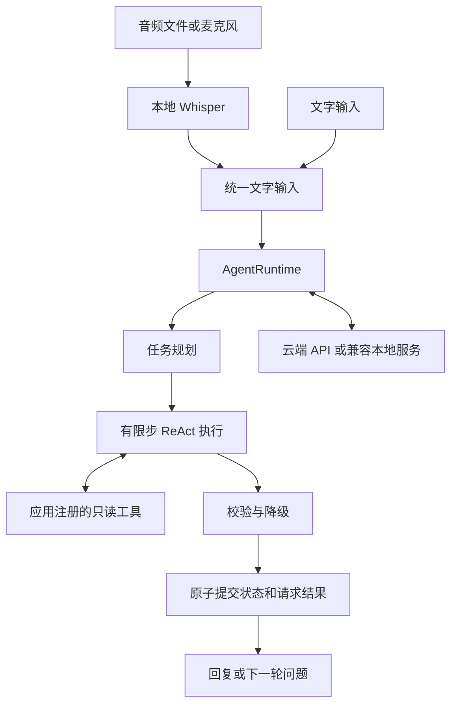

# Voice Task Agent

支持语音输入的任务型 Agent 框架。从 AI 面试官的 Agent 代码中提取通用设计，
将语音输入、模型调用、任务规划、工具执行和会话存储分离。

## 核心结构



核心不包含候选人、岗位、面试评分字段。面试官和知识问答助手都通过
`TaskSpec + ToolRegistry + 应用上下文` 接入同一个运行核心。

## 快速运行

```bash
python -m pip install -e ".[dev]"
voice-agent --demo --app interviewer --context examples/interviewer.json --text "开始面试"
voice-agent --demo --app knowledge --context examples/knowledge.json --text "What is Whisper?"
python -m pytest -q
```

`--demo` 是确定性的离线演示，不是大模型。真实模型使用 `AGENT_BASE_URL`、
`AGENT_MODEL`、`AGENT_API_KEY` 配置；API 和本地服务均须兼容 Chat Completions。
依赖供应商和模型能力，可能需要把 `AGENT_RESPONSE_FORMAT` 改为 `text`。
接口兼容测试不等同于已验证所有供应商或本地模型。

## 语音输入

```bash
python -m pip install -e ".[voice]"
voice-agent --demo --app interviewer --context examples/interviewer.json --record 5 --language zh
voice-agent --demo --app knowledge --context examples/knowledge.json --audio question.wav
```

只有显式指定 `--record` 才会打开麦克风。模型首次加载可能下载权重；可通过
`--asr-model` 指定已有模型目录。当前处理完整的一段录音，不提供流式识别、TTS 或打断。
离线测试验证语音适配层与核心之间的数据流；实际麦克风、识别效果和真实模型需要单独验收。

## 可靠性设计

- 限制每轮时间、模型调用时间、工具调用次数和输出修复次数。
- 工具使用 Pydantic 参数模型、名称白名单及重复调用检测。
- SQLite 保存版本化会话和已完成请求；同一请求重放不会再次调用模型。
- 请求处理和状态提交分离，取消或提交失败不会发布半个会话轮次。
- 异常返回明确降级结果，不把模型故障包装成成功回答。
- 只读工具优先；当前不支持有外部写入副作用的工具，也不声称“恰好执行一次”。

同一会话同时只处理一个请求。进程崩溃后，先停止旧进程，再用 `--recover` 释放
未完成请求。运行数据库包含对话内容，属于本地私有数据，不应加入源码仓库。

更多运行命令见 [英文 README](README.md)，提取关系见 [来源说明](docs/PROVENANCE.md)，
验证范围见 [验证记录](docs/VALIDATION.md)。
